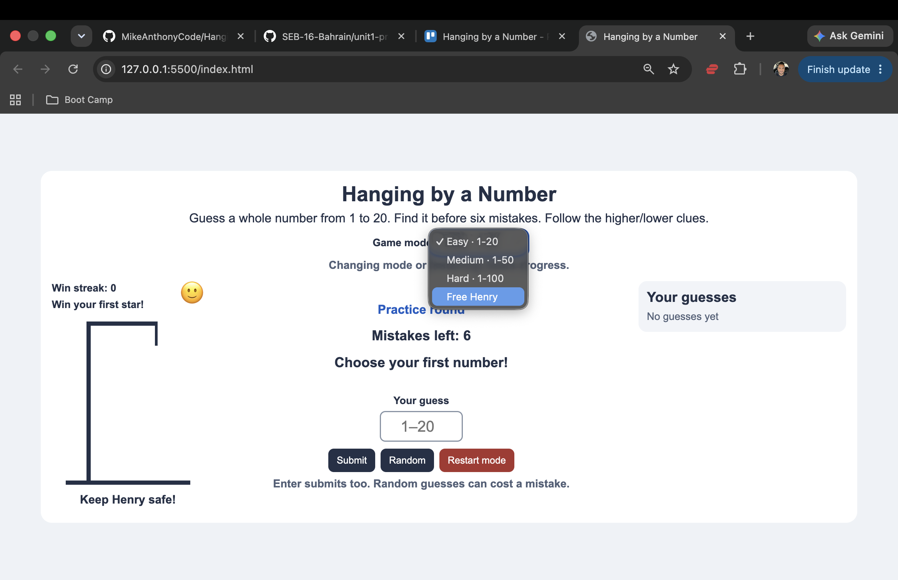
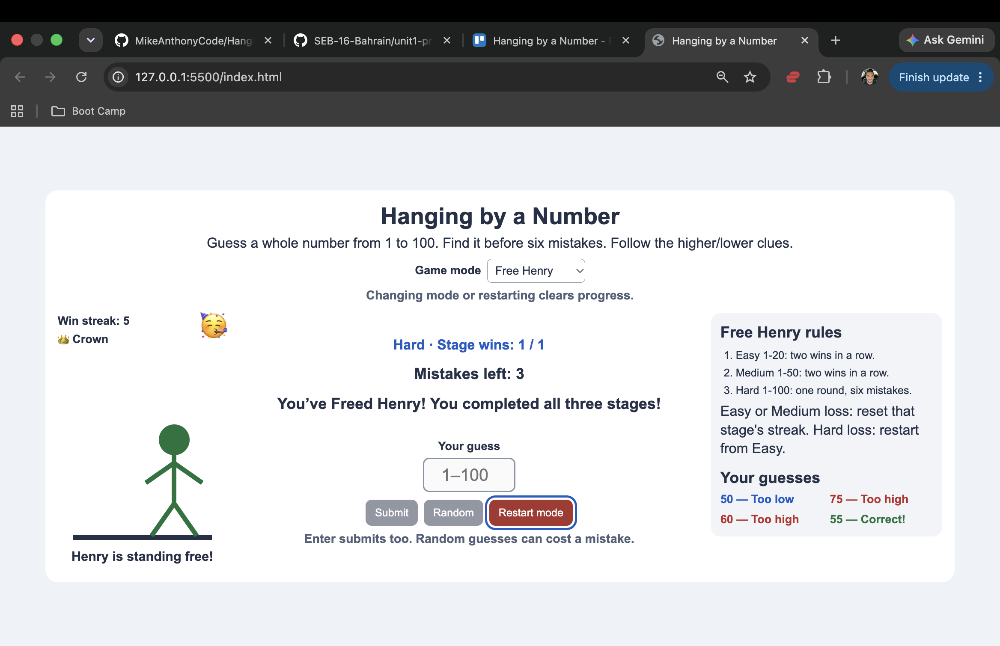

# Hanging by a Number
A browser number guessing game with a hangman twist. Use higher/lower clues to find the secret number before six wrong guesses complete Henry’s drawing (and he is hanged....don't worry he has multiple lives).

## Getting started
Open index.html in your browser. No installation is needed. Select a mode, enter a whole number, and click Submit or press Enter. Random submits an untried number and can cost a mistake.
Deployment is pending instructor confirmation. A verified playable link will be added after approval and publication.
[Planning](planning/PLAN.md) | [Testing](docs/TESTING.md) | [Requirements](docs/REQUIREMENTS.md)
## Rules
- Easy: 1–20. Medium: 1–50. Hard: 1–100.
- A correct guess wins. Six incorrect guesses lose a round.
- Invalid and duplicate guesses do not cost a mistake.
- Free Henry requires two consecutive Easy wins, two consecutive Medium wins, and one Hard win. Every round allows six mistakes.
- An Easy or Medium loss resets that stage’s consecutive wins. A Hard loss ends the rescue.
- Next continues progress. Restart or changing mode clears it.

## Technologies used
HTML, CSS with Flexbox, and vanilla JavaScript using the DOM. Henry is drawn with CSS shapes. No external game libraries are used.
## Next steps
- Obtain instructor confirmation and publish the approved game.
- Add an optional sound toggle.
- Explore saving a best streak after learning browser storage.